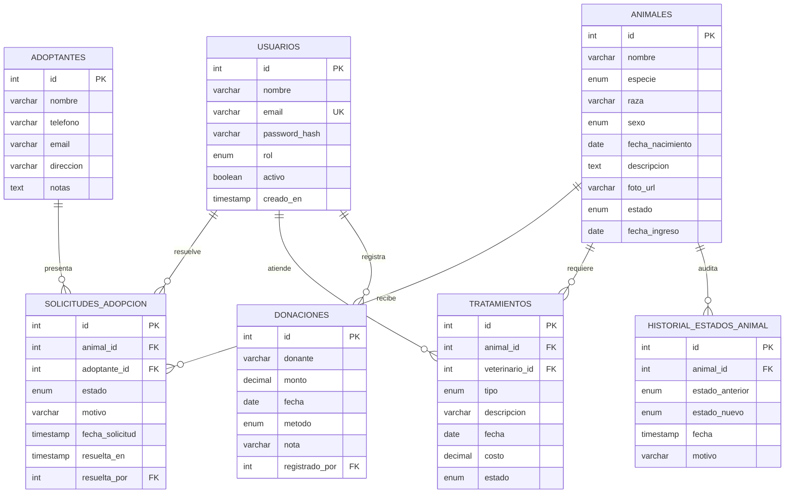

# Diagrama entidad-relación

## Relaciones

- Un usuario puede resolver muchas solicitudes de adopción (`resuelta_por`).
- Un usuario veterinario puede atender muchos tratamientos.
- Un usuario puede registrar muchas donaciones.
- Un animal puede recibir muchas solicitudes de adopción.
- Un adoptante puede presentar muchas solicitudes.
- Un animal puede requerir muchos tratamientos.
- Un animal puede tener muchos registros de historial de estados.

## Notas de normalización

- El modelo está en tercera forma normal: cada tabla almacena hechos de una sola entidad y las referencias se resuelven mediante claves foráneas.
- El nombre del adoptante y del animal no se duplican en las solicitudes; se obtienen mediante las vistas de detalle.
- El historial de estados se separa de `animales` para conservar trazabilidad sin redundancia.
- `email` en `usuarios` es único; se definieron índices sobre estados, especies, nombres y fechas para las consultas frecuentes.
- Las reglas de negocio críticas viven en la base de datos:
  - Validación y transiciones de estado de solicitudes (triggers).
  - Auditoría de cambios de estado de animales (trigger).
  - Aprobación transaccional con rechazo de solicitudes rivales (`sp_aprobar_solicitud`).
  - Validación de montos de donaciones (trigger).
- Los reportes usan vistas y procedimientos, incluyendo `RANK()` para el ranking de donantes.

## Restricciones principales

- `solicitudes_adopcion.animal_id` y `adoptante_id` son claves foráneas obligatorias.
- Una solicitud resuelta no puede volver a cambiar de estado.
- Solo se puede solicitar la adopción de animales disponibles.
- No se permiten dos solicitudes pendientes del mismo adoptante para el mismo animal.
- El monto de una donación debe ser mayor que cero.
